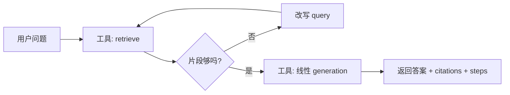

# 04 后续演进规范

> RAG 复习助手 · P1 及以后的功能、架构扩展与迁移约定  
> 2026年8月 · 与当前仓库进度对齐
> **当前基线（2026-10-09）**：对话默认由 Agent 调度，RAG 已注册为工具；工具决策失败时降级执行 RAG 工具。P2-B 固定图仅保留为显式兼容入口。

---

## 4.0 文档定位

| 文档 | 阶段 | 职责 |
|------|------|------|
| 01 产品边界 | P0 已定 + 简述 P1/P2 | 做什么、不做什么 |
| 02 模块架构 | P0 实现规格 | 目录、API、单课数据模型 |
| 03 工程规范 | P0 实现规格 | uv、FastAPI、部署 |
| **04 后续演进（本文）** | **P1～P3 状态与规划** | 记录已落地项、未完成边界与后续迁移约定 |

**原则**：
- P0 的 `services/` 主链路（ingestion → retrieval → generation）**不因 Agent 或多学科而重写**，只做扩展。
- Agent（LangGraph）是默认对话编排；RAG 注册为 `rag_answer` 工具，复用检索与生成能力。`query.py` 负责意图、会话范围与持久化。
- 多学科隔离靠 **`course_id` 元数据 + 检索 filter**，不靠多个独立部署。
- 资料证据治理：版本、时效、权威为可比较元数据；适用范围采用人工确认的受控场景键，检索先过滤再择证。

---

## 4.1 演进阶段总览

| 阶段 | 主题 | 交付物 | 依赖 |
|------|------|--------|------|
| **P0** | 单课 RAG MVP | `/health`、`/documents`、`/ask`、拒答、引用 | — |
| **P0.5** | 检索可测 | `golden_qa.jsonl`、只测 `retrieval` 的 pytest | P0 |
| **P1-A** | 多学科隔离 | `colleges` / `courses`、API 带 `course_id`、检索 filter | P0 |
| **P1-B** | 检索增强 | BM25 + RRF、`mode=concept`、PPT 解析 | P0 |
| **P2-A** | 质量与模式 | Reranker、`mode=chapter`、离线 Recall@K / MRR | P1 |
| **P2-B** | Agent 循环 | LangGraph、`POST /agent/run`（或 `ask` 增 `use_agent`） | P1、RAG 稳定 |
| **P2-C** | 决策型 Agent | 受控 function-calling 决策环、工具调用观测、默认 Agent + RAG 工具 | P2-B、模型支持 tools |
| **P3** | 平台化 | 用户登录、课程 ACL、PostgreSQL + pgvector、异步入库 | P2、有明确需求再做 |

**当前进度**：P0 → P0.5 → P1-A → P1-B → P2-A → P2-B → P2-C 已完成；P2-C 已成为默认对话路径，P3 按需启动。

**题库扩展**：已增加“我的题库”作为 P2-C 的受控生成能力：`POST /question-bank/generate` 先检索当前课程的有效资料，再生成并保存题目草稿；题目保存证据引用、资料版本、题型、难度与章节。题目可手动维护，多个同课程题目可保存为试卷。`POST /question-bank/papers/assemble` 接收题型、难度、章节、题数与分值蓝图，优先复用带有效证据的题目，缺题才补生成，并在去重、课程、题数与总分校验通过后保存。此能力不授予 Agent 写入资料库的权限，写入范围仅限题库 SQLite 表。

---

## 4.2 多学院 · 多学科隔离（P1-A）

### 4.2.1 目标

- 不同课程（如「默认课程」与「思政原理」）**互不串库、互不串答**。
- 用户在前端 **先选学院（可选）→ 再选课程**，再问问题。
- 不要求 P1-A 做登录；内网共用、靠 **`course_id` 显式选择** 隔离。

### 4.2.2 组织模型

```
college（学院）
  └── course（课程 / 学科）     ← 检索隔离边界
        └── document → chunks
```

| 实体 | 说明 | 示例（产品默认种子） |
|------|------|------|
| `college_id` | 学院标识 | `college-default` |
| `college` | 展示名 | 默认学院 |
| `course_id` | 课程标识（**检索 filter 主键**） | `course-default` |
| `course` | 展示名 | 默认课程 |

> 历史种子 `college-telecom` / `course-signals-2025` 启动时迁到默认课。跨课负例可用 `course-ideology-2025` 等非默认 ID。

### 4.2.3 数据模型变更（相对 02 §2.6）

**SQLite 新增表**：

```sql
-- 学院
colleges(id TEXT PRIMARY KEY, name TEXT NOT NULL, created_at TEXT)

-- 课程（学科）
courses(id TEXT PRIMARY KEY, college_id TEXT NOT NULL, name TEXT NOT NULL, created_at TEXT,
        FOREIGN KEY(college_id) REFERENCES colleges(id))

-- documents 表变更：course 字符串 → course_id 外键
documents(..., course_id TEXT NOT NULL, ...)
```

**Chunk metadata（Chroma）**：

```python
{
    "doc_id": str,
    "college_id": str,
    "course_id": str,          # ★ 检索必 filter
    "course": str,             # 展示
    "source_file": str,
    "page": int | None,
    "chunk_index": int,
    "chapter": str | None,
    "doc_type": str | None,
}
```

**规则**：
- 入库时必须写入 `college_id`、`course_id`。
- 检索时 **必须** `filters={"course_id": course_id}`，禁止无 filter 全库搜索。
- 删文档：同步删向量 + 更新 `doc_store`（同 P0）。

**向量库策略（P1-A）**：单 Chroma collection + metadata filter（课程数 < 约 50 时足够）。课程量极大再评估「每课一 collection」。

### 4.2.4 API 变更

| 方法 | 路径 | 阶段 | 说明 |
|------|------|------|------|
| GET | `/colleges` | P1-A | 学院列表 |
| GET | `/courses` | P1-A | 查询参数 `college_id`（可选） |
| POST | `/documents` | P1-A 改 | **必填** `course_id`（multipart 字段） |
| POST | `/ask` | P1-A 改 | **必填** `course_id`；保留 `mode` |
| GET | `/documents` | P1-A 可选 | `?course_id=` 资料列表 |

**POST /ask 请求示例**：

```json
{
  "question": "思政课的考试题型有哪些",
  "course_id": "course-ideology-2025",
  "mode": "qa"
}
```

**校验**：
- `course_id` 不存在 → 404
- 检索结果为空或分数低于阈值 → `grounded: false`（同 P0 拒答）

### 4.2.5 services 变更

```python
# 签名扩展（P1-A）
ingestion.ingest_file(path, course_id: str) -> doc_id
retrieval.retrieve(question, course_id: str, top_k: int = 5) -> list[ScoredChunk]
query.ask(question, course_id: str, mode: str = "qa") -> Answer
```

新增 `storage/catalog_store.py`：学院/课程 CRUD，供 apis 与校验使用。

### 4.2.6 前端

Vue UI 已挂载于 `/sz/`，包含对话、资料、题库、练习和设置路由。契约：选课后 ask / upload / scan / list / delete 均须带当前 `course_id`；顶栏展示当前课程名。当前运行与界面约定见 [前端 README](../frontend/README.md)，练习契约见 [08-练习与问答质量.md](./08-练习与问答质量.md)。
### 4.2.7 测试

`golden_qa.jsonl` 每行增加 `course_id`：

```json
{
  "course_id": "course-default",
  "question": "傅里叶变换时移性质",
  "expected_contains": ["时移"]
}
```

**负例**：用 A 课问题 + B 课 `course_id`（如 `course-ideology-2025`），不得命中 A 课 chunk。

---

## 4.3 检索与查询模式增强（P1-B / P2-A）

### 4.3.1 P1-B：混合检索 + 知识点 + PPT

| 项 | 实现位置 | 说明 |
|----|----------|------|
| BM25 | `services/retrieval.py` 或 `services/retrieval_bm25.py` | 按 `course_id` 隔离索引 |
| RRF 融合 | `retrieval.py` | 向量 top_k + BM25 top_k → 融合 |
| `mode=concept` | `query.py` + `generation.py` | 更大 top_k + 聚合 prompt |
| PPT | `ingestion.py` | python-pptx，按 slide 分块 |

`query.ask` 签名不变（已含 `course_id`、`mode`）。

### 4.3.2 P2-A：精排与章节概览

| 项 | 实现 | 说明 |
|----|------|------|
| BGE-Reranker | `retrieval.rerank()` 或 postprocess 步骤 | 对融合结果精排 top 3～5 |
| `mode=chapter` | `query.py` | **不走语义检索**；`doc_store` + metadata 按 `chapter` 聚合 chunk → LLM 概览 |
| 离线评估 | `tests/eval/` 或脚本 | Recall@5、MRR；按 `course_id` 分集统计 |
| LLM 切换 | `config.py` + `llm.py` | 多 provider 配置，不改业务层 |

### 4.3.3 可选：会话内短期上下文（P1 末 / P2）

- **不是**跨会话长期记忆。
- `POST /ask` 可选字段 `history: [{role, content}, ...]`（最近 3～5 轮）。
- 仅辅助指代（「刚才那个公式」）；**答案仍以 RAG citations 为准**。
- 不写入向量库。

---

## 4.4 Agent 循环（P2-B · LangGraph 历史设计）

本节至 §4.4.7 保留最初固定图与独立端点方案的设计记录；其中“默认线性 `/ask`”已被 §4.4.8 的默认 Agent 入口替代。

### 4.4.1 引入条件（已满足）

引入 Agent 所需的以下条件已满足：

1. P0 + P1-A 稳定，多学科不串答。
2. 线性 `query.ask` 已满足大部分问答。
3. 有明确 **多步任务** 需求，例如：
   - 检索不够 → 换关键词再检 → 再答
   - 根据本章资料 **自动生成 5 道选择题**
   - 对比两份重点文档差异

若只需「问一句答一句 + 引用」，**不要上 Agent**。

### 4.4.2 架构原则

```
                    ┌─────────────────────────┐
  POST /agent/run   │  services/agent/        │
  或 ask+use_agent  │  LangGraph 状态图        │
                    └───────────┬─────────────┘
                                │ 调用工具（不重写 RAG）
                    ┌───────────▼─────────────┐
                    │  retrieve(course_id)    │  ← services/retrieval.py
                    │  ask(course_id, mode)   │  ← services/query.py（可选）
                    │  list_documents(...)    │  ← doc_store
                    └─────────────────────────┘
```

- **LangGraph 只做编排**；检索、生成、入库逻辑仍在 `services/`。
- **不**用 Agent 替代 `retrieval.py` / `generation.py`。
- **不**引入 MCP、Skills 框架；工具函数直接调 Python service。

### 4.4.3 目录扩展

```
src/services/
├── agent/
│   ├── graph.py           # LangGraph 图定义
│   ├── state.py           # AgentState（question, course_id, steps, citations...）
│   ├── tools.py           # 包装 retrieve / ask / list_docs
│   └── nodes.py           # 节点：retrieve, grade, rewrite_query, generate, finish
├── query.py               # 保留；线性问答默认路径
└── ...
```

```
src/apis/v1/
├── ask.py                 # 默认线性 RAG
└── agent.py               # POST /api/v1/agent/run（P2-B）
```

### 4.4.4 典型 Agent 循环（复习场景）



**Grade（是否够）**：可规则（top score < 阈值）或小模型判断；**不够则改写 query 再检，最多 N 轮（如 2～3）**，防止死循环。

**状态字段示例**：

```python
class AgentState(TypedDict):
    question: str
    course_id: str
    mode: str
    queries: list[str]          # 含改写历史
    chunks: list[ScoredChunk]
    citations: list[Citation]
    answer: str
    grounded: bool
    steps: list[str]            # 可观测：检索了几次、改了什么 query
```

### 4.4.5 API

**方案 A（推荐）**：独立端点，线性 `/ask` 不变。

```
POST /agent/run
{
  "question": "根据第3章资料出5道选择题",
  "course_id": "course-signals-2025",
  "max_steps": 5
}
```

响应在 P0 `answer + citations + grounded` 基础上增加：

```json
{
  "code": 200,
  "data": {
    "answer": "...",
    "citations": [...],
    "grounded": true,
    "steps": ["retrieve: 初始问句", "grade: 不足", "retrieve: 改写后...", "generate: 出题"],
    "agent_used": true
  }
}
```

**方案 B**：`POST /ask` 增加 `"use_agent": true`（简单但易与线性路径混淆；优先方案 A）。

### 4.4.6 依赖与工程

- 依赖：`langgraph` 已写入 `pyproject.toml` 与 `uv.lock`，`uv sync` 即会安装。
- Agent 路由同样 **必填 `course_id`**，工具层强制 filter。
- 日志：每个 node 打 INFO（question、course_id、检索次数）；`steps` 返回给前端可选展示「思考过程」。
- 测试：mock LLM + 固定 retrieve 结果，测循环次数上限与拒答。

### 4.4.7 明确不做

| 项 | 原因 |
|----|------|
| MCP | 无多外部工具生态需求 |
| Skills 插件市场 | 用 `query` mode + Agent tools 足够 |
| Agent 写向量库 | 资料只经 `ingestion` 入库 |
| 无 course_id 的 Agent 全库漫游 | 必串答 |

### 4.4.8 决策 + 执行型 Agent（P2-C · 已实现）

> 让模型自己决定「下一步做什么」，而非固定状态图 + 规则分支。`/ask` 和 `/agent/run` 默认启用；RAG 是 Agent 工具。

**目标**：把 P2-B 的固定循环（retrieve → grade → rewrite/generate）升级为 **LLM 自主决策 + 工具调用（function calling）**。模型根据上下文与可用工具清单，自己选择调用哪个工具、调用几次，直到给出最终答案。

**当前落地边界**：

1. `/ask` 与 `/agent/run` 默认使用模型工具决策；决策失败或 LLM 未配置时降级执行注册的 RAG 工具。
2. `agent/tools.py` 已提供 `rag_answer` 及五个补充取证工具、OpenAI function schema、白名单分发与 `course_id` 强制注入。
3. 工具层单测已覆盖 schema 完整性、未知工具拒绝和分发。
4. `llm.py` 的 `chat_with_tools` 将模型输出归一为 `content` / `tool_calls`；Agent state/graph 实现 `messages → tool_calls → tool result` 条件循环。
5. `AgentRunRequest.agentic` 默认 `true`，仅显式 `false` 时使用旧固定图；响应返回脱敏工具调用观测，不泄漏模型原始载荷。

**架构红线**（延续 §4.4.2、§4.4.7）：

- LangGraph 只做编排；检索、生成、入库仍在 `services/`，**不重写 P0 主链路**。
- 工具是 Python service 薄封装，**不引入 MCP / Skills**。
- 每个工具强制 `course_id` filter，禁止无 course_id 全库漫游。
- 工具不写向量库、不读写文件系统 / 外部网络；资料只经 `ingestion` 入库。
- 拒答底线：`grounded: false` 时不得编造。

**决策环**（ReAct 式）：

```
用户问题
  ↓
LLM 决策节点（输入 messages + 工具清单，输出 tool_calls 或最终回答）
  ├─ 有 tool_calls → 工具执行节点 → 结果回填 messages → 回到决策
  └─ 无 tool_calls → 生成最终回答 / 拒答 → finish
```

**文件进度**：

| 文件 | 状态 | 说明 |
|------|------|------|
| `src/services/agent/tools.py` | 已完成 | 五个只读工具、`TOOL_SCHEMAS`、`execute_tool` 白名单分发 |
| `tests/agent/test_agent_tools.py` | 已完成 | 工具行为、schema、未知工具与调度测试 |
| `pyproject.toml` / `uv.lock` | 已完成 | `langgraph` 已纳入依赖 |
| `src/services/llm.py` | 已完成 | `chat_with_tools(messages, tools)` 透传 tools / tool_choice，并归一化 `tool_calls` |
| `src/services/agent/state.py` | 已完成 | `messages`、待执行调用、调用观测和工具轮数 |
| `src/services/agent/nodes.py` | 已完成 | `agentic_agent_node` 与 `agentic_tool_node`，含参数白名单和无证据拒答 |
| `src/services/agent/graph.py` | 已完成 | 保留 P2-B 固定图，P2-C 新增 `agent ↔ tool` 条件循环及上限 |
| `src/models.py` / `apis/v1/agent.py` | 已完成 | `agentic` / `scenario` / `as_of` 请求字段与 `tool_calls` 观测响应 |

**已落地工具清单**：

| 工具 | 用途 | 复用 |
|------|------|------|
| `search_pdf` | 混合检索相关片段并返回引用 | `retrieval.retrieve` |
| `read_page` | 按文档与页码读取已入库切片 | `vector_store.get_chunks` |
| `extract_table` | 按语义或文档/页码提取表格切片 | `vector_store.search/get_chunks` |
| `analyze_chart` | 基于入库时的视觉摘要分析图表 | `image_summary` 切片 + 可选 LLM |
| `quote_source` | 返回文件、页码、章节和切片路径 | `retrieval.retrieve` |

**API**：`POST /ask` 默认走 P2-C；`POST /agent/run` 的 `agentic` 默认 `true`，显式 `false` 才走 P2-B。两者响应均提供 `steps`、脱敏 `tool_calls`、`agent_used` 与实际 `agentic`。RAG 工具包含 qa/concept/chapter、视觉复核和拒答能力；仅系统传入资料范围和历史。SSE 先报告状态，最终答案通过依据校验后发送正文。

**循环上限**：复用 `max_steps`（默认 3、上限 10）作为最大工具调用轮数，防死循环。

**测试进度**：

- [x] 工具 schema 与白名单一致。
- [x] 未知工具名拒绝，已知工具正确分发。
- [x] 工具层由系统注入 `course_id`，不向模型暴露跨课参数。
- [x] mock LLM 返回固定 `tool_calls`，验证决策环路由与 `max_steps` 限制。
- [x] 验证 P2-C 决策环在 `grounded: false` 时不编造。

**风险**：

| 风险 | 缓解 |
|------|------|
| LLM 不支持 function calling | 启动前实测；不支持则降级执行注册的 RAG 工具 |
| 成本 / 延迟上升 | `max_steps` 上限 + 控制工具粒度 |
| 自主决策失控（死循环 / 越界） | 工具白名单 + `course_id` 强制 + 循环上限 |
| 拒答底线被破坏 | 生成前强制校验 `grounded` |

**明确不做**：MCP、Skills 插件市场、Agent 写向量库、工具直接读写文件 / 网络、无 `course_id` 全库漫游。

---

## 4.5 权限与平台化（P3 · 按需）

仅在需要「不同学院只能看本院课程」时启动。

| 项 | 做法 |
|----|------|
| 认证 | JWT / Session；扩展 `dependencies.get_current_user()` |
| 授权 | 用户 ↔ 可访问 `course_id` 列表；检索/入库前校验 |
| 存储 | SQLite → **PostgreSQL**；向量 → **pgvector** 或保留 Chroma + PG 元数据 |
| 异步入库 | Celery + Redis；大文件入库走 `tasks/ingest_document` |
| 资料版本 | PDF 已支持内容指纹、影子入库与新旧版切换；P3 再按需添加多人协作、审批和保留策略 |

换库仅替换 `services/storage/` 实现；`ingestion` / `retrieval` / `query` 接口保持不变（见 02 §2.8）。

---

## 4.6 迁移检查清单（P0 → P1-A）

从单课 MVP 升级到多学科时，按序验收：

- [x] SQLite：`colleges`、`courses` 表 + 种子数据（`catalog_store`）
- [x] 现有文档补 `course_id`（列迁移 + 旧种子 ID 归并；无 metadata 的旧向量需重扫）
- [x] Chunk metadata 含 `college_id`、`course_id`
- [x] `ingest_file`、`retrieve`、`ask` 均强制 `course_id`
- [x] `POST /documents`、`POST /ask`、`POST /documents/scan` 缺 `course_id` → 422
- [x] 负例测试：跨 course 检索不命中（`test_retrieval` + golden）
- [x] 前端选课 UI + 请求带 `course_id`（`frontend/` Vue 页面）
- [x] `golden_qa.jsonl` 含 `course_id`

---

## 4.6.1 迁移检查清单（P1-B）

- [x] BM25 按 `course_id` 隔离（`vector_store.get_by_course_id` + `_bm25_search`）
- [x] 向量 + BM25 → RRF 融合（`retrieval.retrieve`；`ask` 签名不变）
- [x] `mode=concept`：更大 `top_k` + 聚合 prompt（定义→公式→例题）
- [x] PPT 解析（`parsing._parse_pptx`，P1-A 已落地）
- [x] 单测：`test_retrieval` · `test_ask`（concept）；golden 含 concept + 跨课负例
- [x] 跨课负例：qa / concept 在他课 `course_id` 下仍拒答

---

## 4.6.2 迁移检查清单（P2-A）

- [x] 离线评估：`tests.eval.metrics.recall_at_k` / `mrr`；`tests/fixtures/retrieval_eval.jsonl`；`tests/eval/run_retrieval_eval.py`
- [x] BGE 精排：`rerank.py`（sentence-transformers CrossEncoder）；`RERANK_*` 配置；默认关闭
- [x] `retrieve`：精排开时宽池（`rerank_candidates`）→ RRF → rerank → sigmoid 阈值
- [x] 入库写入 `chapter` 元数据（MD/章标题启发式；弱结构用「第N页」）
- [x] `mode=chapter`：`get_by_chapter` 聚合，不走语义检索；章节概览 prompt
- [x] 评估脚本 `tests/eval/run_retrieval_eval.py`；对话/章节链路 `test_ask`；前端 `qa|concept|chapter`
- [x] 旧库无 chapter：资料页勾选「强制重建」再扫描，或重新上传；普通扫描仅在 mtime 变更时重入库
- [x] `GET /documents/summary?by=type|chapter`：用户可选按文件类型或按内容章节大致分类（章节依赖 `chapter` 元数据）

---

## 4.6.3 迁移检查清单（PDF 结构化解析）

- [x] PDF 类型判断抽样增强（`parsing._pdf_kind`：text / scanned / mixed，不再只看首字符数）
- [x] 解析器默认 `PDF_PARSER=mineru`（MinerU 结构解析；未装/失败回退 pymupdf4llm + OCR）
- [x] 结构还原：`ParsedBlock`（title 层级 / table HTML / formula / image 路径 / caption 关联 / header·footer 保留）
- [x] 语义切片：标题层级 → `section_path`；标题段落合并成组；表格独立成组（列头进 metadata）；图片独立成组
- [x] 丰富 metadata：`block_type` / `section_path` / `table_headers` / `context` 随 chunk 写入 Chroma
- [x] 多模态视觉摘要（可选）：`VISUAL_MODEL` 等配置，对图片/图表生成检索摘要；未配置时回退图片说明或跳过
- [x] 页眉页脚保留在结构里但不进检索正文（避免污染切片）
- [x] 手写资料第一轮语义保真：公式字段兼容 `latex` / `math_content` / `equation`；PDF 物理页、PDF 页签、教材页码/题号引用分字段保存；“考点/注意”等批注独立入库，状态栏/联系方式等明确噪声过滤
- [x] 外部解析器资产持久化：MinerU / MarkPDFdown 临时目录中的裁剪图在清理前复制到 `PARSED_ASSETS_DIR`，供后续视觉摘要读取
- [x] 单测：`test_parsing.TestMineruStructure`（结构还原）· `test_ingest.TestChunkStructured`（语义切片）

---

## 4.7 迁移检查清单（P1 → P2-B Agent）

- [x] 线性 `/ask` 回归仍通过
- [x] Agent 工具仅调用 services，不 duplicate RAG
- [x] `max_steps` / 最大 retrieve 轮数有硬上限
- [x] 每步 `course_id` 不变
- [x] `grounded: false` 时 Agent 不得编造
- [x] `steps` 可日志追溯

---

## 4.7.1 迁移检查清单（P2-B → P2-C）

- [x] 只读工具：`search_pdf` / `read_page` / `extract_table` / `analyze_chart` / `quote_source`
- [x] OpenAI function schema 与工具白名单分发
- [x] 工具层由系统强制注入 `course_id`
- [x] 工具注册、行为与未知工具拒绝单测
- [x] `llm.chat_with_tools` 与 `tool_calls` 解析
- [x] `messages → agent_node → tool_node → agent_node` 条件循环
- [x] `/agent/run` 的 `agentic` 开关与工具调用观测响应
- [x] P2-C 循环上限、降级、拒答回归；跨课由系统强制 `course_id` 注入

---

## 4.8 与 01～03 的衔接

| 原约定 | 演进后 |
|--------|--------|
| 01「不做 Agent（P0）」 | P2-B 允许 Agent，见本文 §4.4 |
| 01 产品名「信号与系统」 | 产品扩展为多课程；P0 仍可用单课 seed |
| 02 `course` 字符串 | P1-A 改为 `course_id` + 目录表 |
| 02 API 3 端点 | P1-A 增 `/colleges`、`/courses`；P2-B 增 `/agent/run` |
| 03 LangGraph P2 可选 | P2-B 已纳入依赖并落地，实现细节见本文 §4.4 |

**文档状态**：01 产品边界与 02 当前架构已回写 P1–P2-C 进度；P2-C 已成为默认入口，P2-B 仅保留显式兼容。

---

## 4.9 演进路线图（一图）

```
P0     单课 RAG ──────────────────────────────────────────────┐
P0.5   golden 检索测试                                         │
P1-A   学院/课程 + course_id 隔离 ◄── 多学科必做               │
P1-B   BM25 / concept / PPT                                    │
P2-A   Reranker / chapter / 离线评估                           │
P2-B   LangGraph Agent 循环 ◄── 多步任务可选                   │
P2-C   LLM 决策 + 工具调用 ◄── 默认 Agent + RAG 工具 │
P3     登录 ACL / PG / 异步入库 ◄── 平台化按需                 │
                                                               │
         02/03 主架构不变 ──────────────────────────────────────┘
```

---

## 4.10 实施建议

1. 默认入口使用 P2-C；保留 RAG 工具降级与 P2-B 显式兼容，不重复实现检索和生成。
2. 更换 LLM 提供商时，先实测其是否稳定返回 `tool_calls`，确认默认 Agent 路径的效果与延迟。
3. 每完成一阶段，跑单测、跨课负例与对应 `course_id` 的 golden 集。
4. 若本文与代码冲突，以已验证代码为准，并在同一变更中回写 README、02 当前架构和本文迁移清单。

## 4.11 本地练习闭环与问答质量基线（已实现）

问答引用增加 evidence_role 区分模型选用与检索候选。当前请求中的临时证据编号不进入全局存储标识，也不能绕过课程/场景/时效筛选；非法或未返回编号时保留候选供核对。旧客户端忽略该可选字段即可，旧记录默认候选。详细实测与限制见 `08-练习与问答质量.md` 第二轮记录。

- 在现有 QuestionBankStore 增加 `question_bank_practice` 表，保存课程、题目快照、作答、判分方式、状态、前一次作答及时间。首次打开自动建表，旧题库数据无需重建。
- 状态为 `started → graded`（选择题）或 `started → submitted → graded`（主观自评）。请求标识保障开练幂等；重复提交同一答案返回原记录，修改已提交答案拒绝。
- 最近一次已判分结果为错才进入错题队列；重练未提交或未自评不会提前消除旧错题。复习优先未完成、待自评、错题，再补未练题，默认最多 5 条。统计仅描述最近 7 天事实，不推断掌握度。
- 历史证据检查课程、活动状态、生效期、文件、版本和重建时间。失效证据标记为历史参考，不自动绑定新版本或重新评分。
- 固定 30 个问题及原文锚点，live 评估使用临时库，不修改实际资料库。范围和结果见 `08-练习与问答质量.md`。
- 回退代码不删除新表；完全回退数据前先备份 SQLite，历史练习不参与向量库重建。


## 对话出题任务

示例：“根据第三章资料生成 5 道中等难度选择题，保存为草稿”。Agent 在当前课程和场景/日期范围内，按 `retrieve_evidence → generate_question_drafts → validate_question_drafts → save_question_drafts` 决策循环执行；校验失败可重生成，最多 6 轮。缺少章节/知识点、题数或题型时先澄清，难度默认中等。单一出题与混合组卷均支持一次 1—10 道选择/填空/简答题。

没有明确保存要求时只返回可预览的草稿；“保存这些题目”才执行写入。每题必须绑定当前有效证据 ID，保存前再次核验资料，批内/题库重复以及不受原文支持的题目不得保存。任务结果由工具成功状态形成，不能由模型自行宣称完成。无证据返回固定拒答；工具决策不可用时返回未完成状态，不降级为普通问答后伪装任务成功。

`/ask`（含 SSE）与默认 `/agent/run` 返回 `response_kind`（answer/clarification/status/task_result）、`task`、`artifacts`；SSE 增加 `task` 快照事件。`/agent/run` 可传 `conversation_id`，默认出题任务最多 6 轮，显式 `max_steps` 仍优先。任务使用同一对话的 SQLite 检查点，支持“重试刚才的任务”“继续刚才的任务”“取消任务”；删除对话会删除检查点，不引入跨会话长期记忆。题库保存批次按任务 ID 原子去重，已保存后重试不会重复新增。取消在工具边界生效，已完成的写入保留。

对话展示任务目标、步骤、草稿和题目链接，完成后保留在对话里。通过题目链接打开题库时定位该题。启动旧数据时自动建 `agent_tasks`、`question_task_saves` 表，无需重建资料或题库。

### 对话组卷与执行记录

`kind=paper_assemble` 使用 `retrieve_evidence → prepare_paper_draft → validate_paper_draft → save_paper_draft`。题库与 Agent 共用 `question_bank.prepare_paper` 的确定性蓝图选择，不复制组卷主链路。Agent 的补题先返回未保存草稿，复用题目必须将已有引用匹配到当前课程、场景与日期下的有效检索片段；随后独立校验所有题目的答案和解析。校验失败后可避开本轮被拒绝的复用题重新组卷。

自然语言蓝图支持“2道选择题每题5分，1道简答题每题10分”或“选择题2道每题5分”。名称默认“主题+练习卷”，可用“标题：…”指定。每题大于0且不超过100分，总题数1—10；未说明分值或显式总分不一致时先澄清。默认只复用现有题库，明确“缺题补题”才允许生成；未明确保存时仅预览。超出支持语法的蓝图应继续澄清，不能让模型自行修改题数、分值或写入授权。

试卷保存前重新核对有效证据，复用题目以更新时间校验快照。新增题目、试卷、题目顺序/分值和 `paper_task_saves` 批次在单一 SQLite 事务中提交；失败整批回滚，按任务ID/课程幂等。重复保存返回已有试卷；已删除的试卷不自动重建。取消继承任务边界语义，已提交的写入保留。现有题库直接组卷接口仍保持原行为。

SSE 增加 `tool` 事件，`data` 为脱敏执行观察，包含工具名、参数、执行成功/失败、引用数量与错误，前端逐步累积显示；最终 `tool_calls` 为本次请求完整记录。此处“已执行”仅表示工具执行成功，题目验证结论仍来自任务状态。试卷产物为 `artifacts[type=paper]`，对话链接打开 `question-bank?paper_id=…`，通过课程隔离的既有详情接口展示题目、顺序、分值、答案与引用。

验证使用固定模型桩和临时库，覆盖蓝图、授权、依据失效、重复、复用题目变更、回滚与修复循环；浏览器验收验证预览→保存→详情和390px布局。固定模型桩不代表真实模型质量或外部接口连通性。


### 对话复习目标（已实现）

“第三章掌握得不好，帮我复习，每轮1道题”启动 `kind=study_goal`。缺少章节或知识点时先澄清；默认每轮3道中等难度选择题，上限5道。模型只在据源讲解、自测、针对错项复习三种能力中形成1—4步计划，并提供简短执行理由。目标、计划、完成条件、作答和失败观察保存在当前课程的同一对话检查点，不引入跨会话长期记忆。

工具流程为 `build_study_plan → retrieve_evidence → execute_study_step`，自测步骤返回 `waiting_answer` 后停止调用。未提交时所有公开快照均隐藏答案、解析和题目引用；逐题选择后提交 `1:A，2:C`，系统确定性判分，反馈进入后续讲解和规划。用户可用“先讲解，再自测，重新规划”“降低难度，重新规划”调整剩余步骤，已完成步骤保留，每轮最多调整两次。课程、场景、日期仍由系统强制；范围变化会生成新任务并丢弃旧计划、自测和证据。

`finish_study_goal` 校验计划步骤全部执行、至少一轮自测已提交、已有据源讲解，并重新检索比对资料。资料失效或变更时不能沿用旧结果完成。完成仅表示本轮过程已执行，正确率只描述本轮作答，不推断掌握度。未明确授权不写题库；提交后点击“保存本轮自测题”才调用已有题目保存链路，保存前复核证据，按任务与步骤幂等。

前端通过目标卡片展示计划、理由、完成条件、讲解引用和交互自测；执行记录只展示实际工具调用。验证采用固定模型、临时存储和离线行为断言，不代表真实模型规划质量。


#### 作答反馈决策与受控追加

自测提交后必须先执行 `assess_study_progress`，重新确认当前证据，再让受约束模型根据已观测的答案、对错和剩余步骤选择 `continue / review / retest`。模型不能改课程、题数、难度或写入授权，不能以分数推断掌握程度。没有后续讲解的错答不能直接继续结束；`review` 追加据源补讲，`retest` 追加补讲及新自测，工具更新计划并返回实际下一步。

自动追加重测每个目标最多两次，与用户重规划次数分开计数；达到上限后可完成据源补讲，不要求答对才宣称过程完成。新题必须独立验证依据，且不能重复当前对话已提交的题干。反馈检查按自测步骤幂等，重复工具调用不重复插入步骤；检查点保留已提交结果、反馈安排和追加次数。重规划保留已承诺的反馈后续步骤，处于等待作答的旧未提交题被废弃并重新生成。

完成检查增加所有已提交自测均已处理反馈、错项提交后已有带引用的补讲、追加步骤已全部执行。前端显示各轮实际对错、后续安排、简短理由与2次追加上限。原题目保存仍须明确授权，证据变化后重新生成的批次使用不同证据版本标识，不将旧题批次冒充新结果。

离线回归与固定模型 Edge 验收覆盖连续三轮错答、两次不同题干的重测、上限后的据源补讲及390px布局；不证明真实模型的反馈决策质量。

保存授权绑定到明确请求的自测轮次。已授权并提交的旧轮次可以先保存，再执行追加复习；后续新自测恢复为未授权，需再次明确保存。产物保留此前已保存题目，界面区分“此前已保存”与“本轮尚未保存”，重测不得继承旧轮次写入权限。


#### 对话与检查点恢复

`GET /api/v1/conversations/{conversation_id}?course_id=…&limit=200` 读取当前课程归属下的已发布消息、消息总数、当前脱敏任务快照与恢复提示；limit 为1—500，默认最近200条。跨课程或不存在返回HTTP404；读取不调用模型，不执行工具，不变更检查点，不暴露未提交答案、原始证据或内部子任务。历史按数据库插入顺序读取，同毫秒用户/助手消息保持实际顺序。

前端保留现有本地历史、任务快照和工具记录，并合并服务端对话列表。本地缓存缺失时恢复已发布历史，检查点作为独立任务卡展示，历史任务卡不继续提供当前任务操作。未提交任务只提示补充/作答，失败或中断任务由用户明确继续或重试；恢复不自动调用模型。服务端检查点也能恢复本地只有空草稿的首轮中断。超出历史窗口时明确提示最近消息数量，不伪造缺失的历史工具记录。

切换课程或对话取消旧读取；开始新执行后，迟到恢复响应不得覆盖当前过程。删除对话会调用同课程的服务端删除接口，级联删除消息和检查点；此前已明确保存到题库的产物保留。服务端同步失败时保留本地历史并显示错误，仍不引入跨会话长期记忆。

固定模型 Edge 验收覆盖清除隔离浏览器对话缓存后的同一任务恢复、零自动问答请求、未提交答案隐藏、恢复后继续自测与390px布局。


## Agent 交互与任务入口（2026-10-10）

配置了支持工具调用的模型时，普通交流、课程问答与语义任务请求进入同一 `agent ↔ tool` 循环。`intent.py` 的规则与已确认上下文用于课程模式、场景、日期及明确任务控制，不再提前调用另一个模型路由器；含糊需求和不匹配规则的任务由 Agent 根据请求和公开历史选择下一步。明确任务缺参时仍保留确定性澄清，不臆造参数。

模型也可以直接输出普通交流的最终文本，执行同一独立核验后发布，无需工具调用；课程无引用直答不能通过。`agent/interaction.py` 注册两个交互工具：

- `respond_to_user`：模型生成身份、能力、产品帮助、礼貌交流或仅询问缺失需求的回复。身份说明来自服务端产品能力表及实际客户端的 `model` 配置标识，不猜测模型品牌。独立核验使用原始请求、公开历史和可信产品说明，只有严格 JSON 的 `allowed=true` 才发布；格式错误、夹带课程知识、混合请求或虚构本轮执行均拒绝，错误观察回到 Agent 重新决策。已进入本轮课程取证后不能通过交流工具掩盖无证据结果。
- `create_task`：结构化建立出题、组卷或复习目标，也可补充当前课程 `waiting_input` 的同类任务。主题、题数、题型、难度和蓝图受服务端类型与上限校验，缺参先澄清。工具没有课程、场景、日期、补题许可或保存授权字段；这些仍由服务端和实际用户指令控制。启动后回到模型循环，切换到当前任务独立工具白名单，复用原有取证、规划、独立校验、幂等写入链路。

交流及澄清均不伪造课程引用；`grounded=false` 继续表示没有课程资料依据，`response_kind` 区分交流、澄清与课程拒答。普通交流与无任务的澄清正常保存，但不覆盖最近已确认课程意图，也不修改等待补参或作答的检查点。补充任务的范围或已确认参数改变时创建新任务标识、清空旧证据及结果、取消旧授权。只有填入此前缺失参数才继续同一任务。

保存权限必须来自实际用户的明确指令，询问“为什么不能保存”、介绍保存方法、引用他人的保存要求均不能授权。模型参数和历史回复不授予写入权限。课程结论继续要求本轮有效工具证据；出题、组卷与复习完成仍以工具状态为准，任务异常不能降级成普通 RAG 回答。新创建任务同样受这一约束。

`/ask` 同步/SSE 与 `/agent/run` 共用 `query.py` 的范围解析、执行选项、最终响应与消息保存；`/agent/run` 的默认 mode 与 `/ask` 一致为 auto，新增 `scope_override`，返回实际意图，场景和日期传入解析值，显式空值可清除继承。工具调用轮数公共入口默认6，上限10（`/agent/run` 可指定）；显式 `agentic=false` 的旧固定图默认3轮。SSE 先 `routing/reasoning`，仅在调用课程取证工具前报告 `retrieving`，其他工具使用 `working`；实际执行结果通过 `tool` 事件和最终记录发布。工具观察保持完整 JSON，不再按字符截断破坏结构。

模型未配置时，或产品交流请求的工具决策不可用时，`services/dialogue.py` 的完整请求规则仅作为可信产品说明的兼容降级；它不再拦截配置模型下的正常交流，不作为语义能力验收依据。交流输出中的 `<NO_EVIDENCE>`、`<SOURCES>`（含 HTML 转义形式）及课程拒答由服务端直接拦截，不依赖模型核验是否误放行。工具错误先回到 Agent 重试；无法形成有效回答或达到轮数上限时，仅完整匹配产品交流、没有本轮引用及活动任务的请求允许返回可信产品说明，保留实际失败工具记录。纯产品请求误送 RAG 后仍可恢复产品说明；含课程问题的混合请求和课程取证失败不得走这一恢复路径。课程问答决策不可用时仍降级执行同一受范围约束的 RAG 工具。

离线回归覆盖同义身份请求、能力说明、致谢插话、交流独立核验失败、混合问题、失败检索不能伪装交流、语义创建与补参、任务工具切换、范围清除、检查点保存和写入授权。隔离 Edge 使用固定模型与临时数据库验证语义身份、出题澄清、致谢、刷新及390px布局；没有调用真实外部模型，真实模型的理解质量和延迟仍需单独验收。

本轮验证：后端完整离线回归 **396 passed、1 skipped、22 integration deselected**；前端 **29 passed**，lint/build 通过。固定模型 Edge 验收通过，浏览器无页面错误、390px无横向溢出。

## Agent 节点执行控制（2026-10-10）

执行运行时在 `agent/execution.py`，存储抽象在 `storage/agent_run_store.py`。配置且支持工具决策的模型下，两个对话入口为每次执行创建独立 `run_id`，同时作为 LangGraph `thread_id`；未提供 conversation_id 时创建服务端对话并在 execution 返回标识。显式固定图和模型未配置的兼容入口维持原行为。

图的 agent/refuse/fallback 和每个注册工具都是实际独立节点；多工具批次依次执行，单批最多16次调用，工具轮数仍按整批计数。任务的取证、生成、校验、保存分别可观察和设断点；RAG 内部仍复用原 `rag_answer` 工具能力，不拆写入库链路。原生 BaseCheckpointSaver 保存完整图状态、父检查点、中间写入与任务写入，不使用 Python pickle 或仅保存业务任务 JSON 冒充原图状态。

所有节点设置原生 static interrupt_before，执行驱动逐边界检查控制请求，正常模式自动继续。选中断点时停在目标节点之前；继续以同一 thread 的 `None` 输入恢复，单步仅执行一个节点后暂停。再次访问同一断点仍停下。当前正在执行的模型/外部工具不能被强行冻结或回滚；暂停和取消在当前节点结束后生效，已保存结果保留。失败节点通过原生检查点重试，不重放完成节点；普通课程决策失败进入可观测 fallback 节点复用范围受控 RAG，可信产品交流使用原兼容说明。已有业务任务的模型异常保留失败节点，不转为普通问答。

对话在业务任务准备之前原子预约，避免并发请求改写检查点；同对话未完成执行必须先继续或取消。恢复获取数据库租约并每15秒续约；失联超过60秒显示 interrupted，等待用户恢复，禁止后台自动调用模型。已经请求取消的执行即使进程失联也不能恢复。修改当前模型后不能静默沿用旧模型身份上下文，需要恢复原模型或取消重提。任务范围、保存权限、证据校验与批次幂等仍使用原链路；继续/单步不是新的保存授权。

SSE 增加 `execution` 和 `node` 事件：节点实际开始、结束、状态、耗时与脱敏输入/输出摘要。仅返回计数、节点名、任务类型/状态等摘要；不公开图内消息、系统提示词、工具正文、文件路径、证据原文或未提交答案。执行 journal 与完整图状态仅保存在本地，不启用第三方追踪上传。

| 方法 | 接口 | 用途 |
|---|---|---|
| GET | `/api/v1/agent/nodes` | 当前节点名称白名单 |
| GET | `/api/v1/agent/runs/{run_id}?course_id=...` | 脱敏运行状态、时间线与当前检查点标识 |
| GET | `/api/v1/agent/runs/{run_id}/checkpoints?course_id=...` | 最近200个检查点的只读摘要，不能任意回放旧写入节点 |
| POST | `/api/v1/agent/runs/{run_id}/control` | course_id、action（pause/resume/step/cancel/retry/breakpoints），可带 breakpoints 白名单 |

`/ask` 和 `/agent/run` 可传 breakpoints；最终响应含 execution。暂停/失败/取消只返回状态，不发布半截消息；完成结果和 user/assistant 消息及 published 标记在同一 SQLite 事务提交，重复继续不会重复历史。完成但尚未发布的 ready 状态可以重试发布，无需重跑模型。已保存题目/试卷继续由原任务 ID 幂等保护。

对话详情的 executions 加载真实脱敏记录；刷新读取历史和状态，不执行模型。正在运行的记录只读轮询，暂停或失联后展示继续/单步按钮。删除对话级联删除 run、原生检查点、中间写入和节点观察。前端执行面板展示当前执行，不把只读检查点历史当作允许任意重放副作用的时间旅行接口。

验收使用临时数据库和固定模型，覆盖断点、刷新、重建存储/图后恢复、单步、取消、失联租约、并发恢复拒绝、保存前取证重验、重复发布、课程隔离和只读脱敏恢复。真实外部模型延迟及网络中断需另行验收。

验证结果：完整离线后端 **410 passed、1 skipped、22 integration deselected**；最终执行控制专项 **14 passed**（包含旧租约写入隔离）；前端 **35 passed**，lint/build 通过。Edge 验证身份断点、检查点只读历史、刷新后断点保留，以及出题保存前暂停 → 刷新 → 单步保存 → 继续发布；任务卡和题目入口保留。桌面与390px页面均无页面错误或横向溢出。
